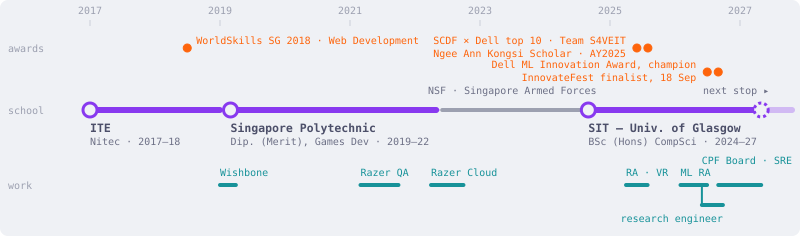

<!-- generated by scripts/build_readme.py — edit data/*.yaml, not this file -->


<picture>
  <source media="(prefers-color-scheme: dark)" srcset="assets/route-dark.svg">
  
</picture>

### `$ cat ~/history.log`

| when | stop | what happened there |
| --- | --- | --- |
| `2017–18` | ITE · Nitec, Social Media & Web Development | First HTML. Competed at WorldSkills Singapore 2018, Web Development. |
| `2019–22` | Singapore Polytechnic · Diploma with Merit, Games Design & Dev | 2 M+ LOC of Unity. Shipped a 4v4 LAN RTS for RSAF and a VR barista sim. Razer QA intern in year 2. |
| `2022` | Razer · Cloud SE intern | Cut Synapse 4 UI load −15 %; built observability tooling. First time systems felt like the point. |
| `2022–24` | National Service · Singapore Armed Forces | — |
| `2024–27` | SIT – University of Glasgow · BSc (Hons) Computing Science | Ngee Ann Kongsi Scholar (AY2025). Firmware, mesh protocols, ML. Top 10 of 120, SCDF × Dell Lifesavers' Innovation Challenge, Team S4VEIT. ML RA (Feb–Jun 2026), then research engineer on a LiDAR telemedicine tool. Champion, Dell Technologies Innovation Awards for Machine Learning (Team 12, Jul 2026); Dell InnovateFest 2026 finalist — finale 18 Sep. |
| `2026–27` | CPF Board · Site Reliability Engineer intern | Sep 2026 – Apr 2027, alongside final year. |
| `2027` | next stop | — |

### `$ jobs`

```text
[1]    done      research-assistant --ml        Feb – Jun 2026        LSTM/GRU/LLM forecasting baselines, SIT
[2]  - running   research-engineer --lidar      Jun 2026 –            LiDAR web modelling for telemedicine, SIT
[3]  + running   innovatefest-2026 --dell       Aug – 18 Sep 2026     finalist · finale 18 Sep, National Gallery
[4]    queued    sre-intern @ CPF Board         Sep 2026 – Apr 2027
```

### `$ ls ~/projects --sort=layer`

| layer | repo | what it proves | measured |
| --- | --- | --- | --- |
| Model | [`online-handwriting-similarity`](https://github.com/hoshinoht/online-handwriting-similarity) | Deep learning model for Chinese handwriting recognition with structural similarity scoring | sub-ms INT8 on-device |
| Model | [`aerial-scene-recognition`](https://github.com/hoshinoht/CSC3109_Project) | Edge-deliverable aerial scene classifier (PatternNet, 4 transport classes) benchmarked across nine architectures on their quantised artifacts, framed as re-tasking satellite and drone vision over a 3-5 Mbps uplink | 12.09 MiB · macro-F1 1.000 (HETMCL-lite) |
| Cluster | [`virtualkopis`](https://github.com/hoshinoht/virtualkopis) | Cloud-native WebRTC video chat platform for seniors with Kubernetes backend and React frontend | 15 peers @ 52 % CPU · <2 % loss |
| Services | [`carehaven`](https://github.com/hoshinoht/Carehaven) | Full-stack caregiver platform for seniors with microservices, real-time alerts, and observability | <1 s SOS · >95 % / <5 % FP |
| Mesh | [`forest-link-protocol`](https://github.com/hoshinoht/forest-link-protocol) | Hybrid ESP-NOW + LoRa mesh protocol for resilient forest IoT deployments, with multi-exit file transfer, cloud telemetry, and remote command routing | 4.3× · >95 % PDR · <15 s |
| RTOS | [`mqttsn-picow`](https://github.com/hoshinoht/mqttsn-picow) | Reliable file transfer between IoT devices using MQTT-SN/UDP on FreeRTOS with custom hardware drivers | QoS 0–2 · 32 KB window |
| Hardware | [`microsd-driver`](https://github.com/hoshinoht/microsd-driver-for-pico-w) | exFAT-compatible microSD card driver for Raspberry Pi Pico W using SPI communication | 1 KB static RAM · ~500 ms init |

### `$ ls ~/agent-tools`

| repo | lang | what it does |
| --- | --- | --- |
| [`opencode-recall`](https://github.com/hoshinoht/opencode-recall) | `TS` | Makes past opencode sessions searchable and auto-injects the relevant ones: SQLite FTS5 (BM25) fused with local embeddings by reciprocal rank fusion; degrades to keyword-only if the embedder is down. |
| [`gofetch-mcp`](https://github.com/hoshinoht/gofetch-mcp) | `Go` | Two tools, one static binary: fetch (HTML/PDF → markdown, section focus, pagination) and web_search (Exa when keyed, keyless fallbacks with 429 backoff). |
| [`researcher-mcp`](https://github.com/hoshinoht/researcher-mcp) | `Go` | Scholarly search and author lookup, provider-first: OpenAlex → Crossref → ORCID, Scholar only as fallback, with structured error codes. |
| [`ats-tailor`](https://github.com/hoshinoht/ats-tailor) | `Py` | The thing that produced the hero. Same instinct: local, hybrid retrieval, no API keys. |

### `$ ls ~/side-quests`

| repo | lang | why it exists |
| --- | --- | --- |
| [`MaplestorySEA-Macos`](https://github.com/hoshinoht/MaplestorySEA-Macos) | `Swift` | MapleStorySEA on macOS via a Wine wrapper. Built because I wanted to play; kept because other people did too. |
| [`dotfiles`](https://github.com/hoshinoht/dotfiles) | `sh` | The rice. Ghostty · Starship · zsh · Catppuccin everything. See also rice-opencode. |

<details>
<summary><code>$ man haoting</code> — skills, by evidence</summary>

**Machine Learning & AI**

- **Deep Learning** — Developed custom LSTM/GRU architectures for long-horizon prediction (ML RA) · ResNet-1D + BiGRU + Attention model with ArcFace for Chinese character recognition ([`online-handwriting-similarity`](https://github.com/hoshinoht/online-handwriting-similarity))
- **LSTM / GRU** — Engineered advanced LSTM and GRU frameworks for time-series prediction (ML RA) · BiGRU layers for temporal modelling in handwriting recognition ([`online-handwriting-similarity`](https://github.com/hoshinoht/online-handwriting-similarity))

**Programming Languages**

- **Go** — Built haven CLI (5,100+ LOC) for Docker orchestration, proto codegen, TLS, Flutter builds ([`carehaven`](https://github.com/hoshinoht/Carehaven)) · 5 gRPC microservices in Go behind a gateway proxy ([`digital-kopitiam`](https://github.com/hoshinoht/digital-kopitiam))
- **Python** — Primary language for ML research (LSTM, GRU, LLM frameworks) (ML RA) · ML pipeline and RAG architecture ([`zensupply`](https://github.com/hoshinoht/Zensupply)) · Flask + MongoDB NoSQL backend ([`ges-monitoring`](https://github.com/hoshinoht/ges-monitoring-system))
- **Rust** — API Gateway, Room Service, Game Service, Signalling Server in Rust ([`virtualkopis`](https://github.com/hoshinoht/virtualkopis)) · Full-stack Axum web app with MongoDB and concurrency primitives ([`budget-tracker`](https://github.com/hoshinoht/budget-tracker)) · Actix Web + SQLite backend with compile-time query verification ([`ges-monitoring`](https://github.com/hoshinoht/ges-monitoring-system))
- **C#** — .NET 10 microservices with Wolverine event-driven messaging ([`carehaven`](https://github.com/hoshinoht/Carehaven)) · 2M+ LOC Unity multiplayer RTS game ([`air-power-domination`](https://github.com/hoshinoht/air-power-domination)) · VR application development in Unity ([`project-sylvestris-vr`](https://github.com/hoshinoht/Project-Sylvestris-VR))
- **C** — MQTT-SN over UDP with FreeRTOS on Raspberry Pi Pico W ([`mqttsn-picow`](https://github.com/hoshinoht/mqttsn-picow)) · Custom exFAT microSD driver via SPI ([`microsd-driver`](https://github.com/hoshinoht/microsd-driver-for-pico-w))

**Cloud & Infrastructure**

- **Docker** — 10+ container production stack with Docker Compose orchestration ([`carehaven`](https://github.com/hoshinoht/Carehaven)) · Containerised all microservices ([`digital-kopitiam`](https://github.com/hoshinoht/digital-kopitiam)) · Full Docker containerization with Docker Compose ([`budget-tracker`](https://github.com/hoshinoht/budget-tracker))

**Observability & Monitoring**

- **Prometheus** — Prometheus metrics collection across all microservices ([`carehaven`](https://github.com/hoshinoht/Carehaven)) · Developed monitoring tools for system observability (Razer Cloud)
- **Grafana** — Grafana dashboards and Tempo distributed tracing ([`carehaven`](https://github.com/hoshinoht/Carehaven)) · Prometheus/Grafana monitoring stack ([`virtualkopis`](https://github.com/hoshinoht/virtualkopis))

**Architecture & Protocols**

- **gRPC** — gRPC API Gateway with dual-protocol mobile app (gRPC-first, REST fallback) ([`carehaven`](https://github.com/hoshinoht/Carehaven)) · 5 gRPC microservices behind gateway proxy ([`digital-kopitiam`](https://github.com/hoshinoht/digital-kopitiam)) · gRPC inter-service communication in Kubernetes ([`virtualkopis`](https://github.com/hoshinoht/virtualkopis))
- **Microservices** — 5 microservices (care tasks, notifications, safety, user pairing, gateway) ([`carehaven`](https://github.com/hoshinoht/Carehaven)) · 5 gRPC microservices (Auth, Room, Signaling, Presence, Wellness) ([`digital-kopitiam`](https://github.com/hoshinoht/digital-kopitiam)) · Kubernetes-deployed microservices with API Gateway ([`virtualkopis`](https://github.com/hoshinoht/virtualkopis))
- **Event-Driven Architecture** — Wolverine/RabbitMQ event-driven messaging across services ([`carehaven`](https://github.com/hoshinoht/Carehaven))
- **API Gateway Design** — Designed gRPC/REST routing gateway with Firebase auth and rate limiting ([`carehaven`](https://github.com/hoshinoht/Carehaven)) · Gateway proxy for 5 microservices ([`digital-kopitiam`](https://github.com/hoshinoht/digital-kopitiam)) · Rust API Gateway in Kubernetes ([`virtualkopis`](https://github.com/hoshinoht/virtualkopis))
- **REST API** — REST fallback alongside gRPC-first mobile app ([`carehaven`](https://github.com/hoshinoht/Carehaven)) · Identical REST APIs across Rust and Python backends ([`ges-monitoring`](https://github.com/hoshinoht/ges-monitoring-system)) · Axum REST endpoints ([`budget-tracker`](https://github.com/hoshinoht/budget-tracker))

**IoT & Embedded Systems**

- **FreeRTOS** — FreeRTOS multithreaded architecture with MQTT-SN over UDP ([`mqttsn-picow`](https://github.com/hoshinoht/mqttsn-picow)) · FreeRTOS priority-tuned tasks for mesh routing ([`forest-link-protocol`](https://github.com/hoshinoht/forest-link-protocol))
- **MQTT / MQTT-SN** — MQTT-SN over UDP with QoS 0-2 and Go-Back-N ARQ ([`mqttsn-picow`](https://github.com/hoshinoht/mqttsn-picow)) · MQTT-SN client for cloud gateway data exfiltration ([`forest-link-protocol`](https://github.com/hoshinoht/forest-link-protocol))

**Game Development**

- **Unity** — Multiplayer PvP RTS with Unity Netcode (2M+ LOC C#) ([`air-power-domination`](https://github.com/hoshinoht/air-power-domination)) · VR application in Unity ([`project-sylvestris-vr`](https://github.com/hoshinoht/Project-Sylvestris-VR)) · Tower defense game with mindfulness techniques ([`ra-virtual-td`](https://github.com/hoshinoht/ra-virtual-td))

**DevOps & Tooling**

- **CLI Tool Development** — Haven CLI (5,100+ LOC Go) for Docker, proto codegen, TLS, Flutter builds ([`carehaven`](https://github.com/hoshinoht/Carehaven))
- **Git / Version Control** — 700+ commits across all submodules ([`carehaven`](https://github.com/hoshinoht/Carehaven))

</details>

### `$ cat ~/contact`

[hoshinoht.dev](https://hoshinoht.dev) · [linkedin.com/in/po-haoting](https://linkedin.com/in/po-haoting) · [pohaoting@gmail.com](mailto:pohaoting@gmail.com)

---

<sub>[YoRHa] system report complete · override sequence accepted at hoshinoht.dev</sub>
